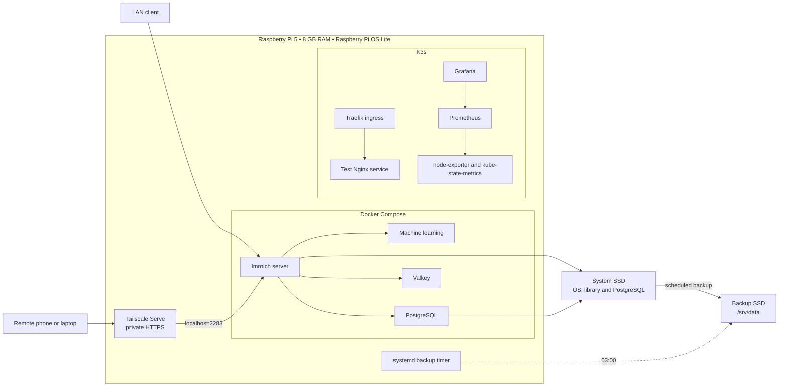
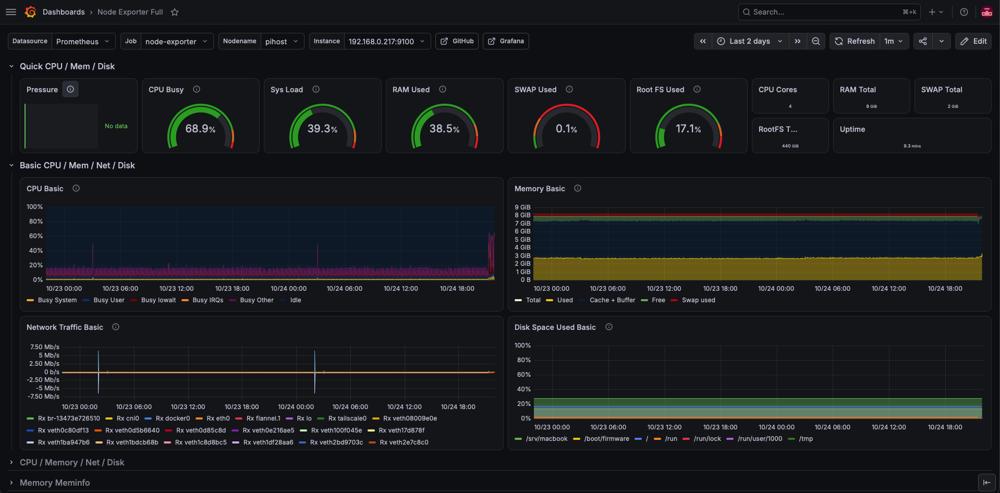

# Raspberry Pi Private Cloud

**Self-hosted photo storage and a Kubernetes homelab on a Raspberry Pi 5.**

I built this homelab to run a private photo library and practice Linux administration, container operations, networking, monitoring and recovery. Immich runs with Docker Compose; a separate K3s installation hosts monitoring and a test web workload.

The project includes a two-SSD storage layout, private HTTPS access through Tailscale Serve, scheduled local backups and troubleshooting of intermittent host failures.

## Infrastructure

| Component | Recorded setup |
| --- | --- |
| Host | Raspberry Pi 5, 8 GB RAM |
| OS | Raspberry Pi OS Lite, booting from SSD without an SD card |
| Storage | Two SSDs, approximately 447 GB each as recorded in the project notes |
| Application | Immich server, machine learning, PostgreSQL and Valkey via Docker Compose |
| Remote access | Tailscale Serve: HTTPS to local Immich on port 2283 |
| Kubernetes | K3s with Traefik and a test Nginx Deployment, Service and Ingress |
| Monitoring | Helm-installed kube-prometheus-stack in namespace `monitoring` |
| Persistence | Prometheus 10 GiB; Grafana 2 GiB |
| Backup | Daily database dump at 02:00; local file/configuration backup at 03:00 |
| Host telemetry | journald plus temperature/throttling metrics through node_exporter's textfile collector |

## Architecture

Grafana is available on the LAN through NodePort 30300. Immich's Tailscale Serve path is separate from the Traefik route used by the test Nginx workload.

## Monitoring dashboard

Grafana Node Exporter Full dashboard with host metrics collected by Prometheus. Captured on 24 October 2026 with a two-day query window; the displayed uptime is approximately nine minutes, so this image illustrates monitoring rather than uninterrupted availability. The Pressure panel has no data in this capture.

## Engineering work

- **Storage migration:** moved active Immich data from the second SSD to the system SSD, preserving PostgreSQL ownership with `rsync --numeric-ids`. The second SSD became the local backup destination.
- **Backup scheduling:** coordinated Immich's database dumps with a later systemd-driven copy of the library and application configuration.
- **Host observability:** added temperature and throttling metrics and corrected a Raspberry Pi OS journald override that prevented previous-boot logs from being retained.
- **K3s networking:** removed a stale IPv6 node address by setting an explicit LAN IPv4 address in persistent configuration; the recorded post-restart address list confirmed the stale address disappeared.
- **Reliability investigation:** checked SSD health, USB link speeds and behavior with the backup disk disconnected. The freeze recurred with one disk, narrowing the investigation without establishing a final root cause.

## Documentation

| Read | Purpose |
| --- | --- |
| [Architecture](docs/architecture.md) | Storage layout, network paths and deployment decisions |
| [Operations and recovery](docs/operations.md) | Backup sequence, health checks, telemetry and recovery gaps |
| [Troubleshooting](docs/troubleshooting.md) | Symptoms, evidence, changes and observed outcomes |
| [Evidence and next steps](docs/evidence.md) | Completed milestones and remaining validation |
| [Configuration excerpts](configs/README.md) | Sanitized excerpts from the recorded setup |

## Current status

The project record reports successful autostart of storage mounts, Immich, K3s, Tailscale, Serve configuration and the backup timer after a reboot. Monitoring was deployed and used during diagnosis.

**Open work:** a documented restore test, off-device backup, full configuration exports, and continued investigation of intermittent host unresponsiveness. Mobile upload troubleshooting is also unresolved in the record. TuneD profiles, Google Photos import and GitOps remain experiments or proposed follow-ups unless explicitly documented otherwise.

This case study is based on the supplied project history, including reconstructed early notes. It describes recorded results, not a fresh audit of the running server or a complete deployment kit.

## Privacy

Published configuration examples replace host addresses and identifiers with placeholders. The repository contains no photo library, database dump, production environment file or full conversation export. Ignore rules help prevent accidental additions but do not inspect content or remove files already tracked by Git.
