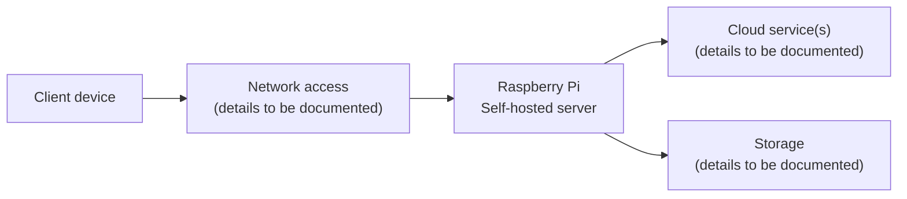

# Raspberry Pi Private Cloud ☁️

**Self-hosted infrastructure · Raspberry Pi · Linux homelab**

> Building a private cloud on my own hardware to explore self-hosting, Linux administration, networking, storage, and infrastructure security.

This repository documents my **Raspberry Pi private cloud project**: the decisions behind it, its architecture, configuration, operational practices, and lessons learned. The goal is not just to show a working service, but to explain **how the infrastructure is designed, maintained, and secured**.

> **Documentation status:** Work in progress. The sections marked *To be documented* will be completed using the actual configuration. No unverified services or security features are claimed here.

## 🎯 Project goals

- Learn how to deploy and manage self-hosted services on a Raspberry Pi.
- Understand the relationship between the operating system, networking, storage, and applications.
- Document practical configuration and troubleshooting decisions.
- Build a reproducible, security-conscious homelab project suitable for a technical portfolio.

## 🏗️ Architecture

The diagram below is a **conceptual overview**, not yet a verified map of the deployed network. The exact network path, services, and storage setup will be documented once confirmed.

### Infrastructure inventory

| Layer | Current documentation |
| --- | --- |
| Hardware | Raspberry Pi — exact model and specifications to be documented |
| Operating system | To be documented |
| Cloud software / services | To be documented |
| Data storage | To be documented |
| Local and remote access | To be documented |
| Network configuration | To be documented |
| Backup and recovery | To be documented |
| Monitoring and maintenance | To be documented |

This table will be updated with **specific versions, configurations, and reasons for choosing each solution**.

## ⚙️ Deployment and configuration

This section will become a step-by-step guide based on the real installation, including:

1. Preparing the Raspberry Pi and operating system.
2. Configuring network connectivity and access.
3. Setting up storage.
4. Installing and configuring the cloud service(s).
5. Validating the setup and documenting how to maintain it.

**Installation commands are intentionally omitted for now:** they must match the actual software stack rather than an assumed one.

## 🔐 Security and privacy

A self-hosted cloud requires careful handling of access to the server and its data. The final documentation will describe **what is actually configured**, including any relevant authentication, network restrictions, updates, or secure remote-access mechanisms.

**Never commit sensitive information**, such as:

- Passwords, API tokens, SSH private keys, or recovery codes.
- Real secrets from environment files or application configuration.
- Personal data and backups.
- Internal network details that are unnecessary for explaining the design.

Where configuration examples are published, sensitive values should be replaced with clear placeholders.

## 💾 Data and backups

Storage and backup strategy are important parts of a private cloud. This section will document:

- How data is stored and mounted.
- Which data should be backed up.
- Whether backups are automatic or manual.
- How recovery can be tested.

**Current implementation:** To be documented. A backup strategy will not be presented as implemented until it is confirmed.

## 🛠️ Operations and troubleshooting

Useful operational documentation will cover routine tasks and actual problems encountered during the build:

| Topic | Notes |
| --- | --- |
| Starting and stopping services | To be documented |
| Checking service health | To be documented |
| Updates and maintenance | To be documented |
| Troubleshooting and fixes | To be documented |

An especially valuable part of this project will be documenting **the problem, the diagnosis, the fix, and what I learned** for real issues.

## 📷 Screenshots and diagrams

This repository will include selected screenshots and an updated architecture diagram once the actual setup is documented. Screenshots will be reviewed to avoid exposing private files, identities, network addresses, or credentials.

## 📚 What this project demonstrates

This homelab is an opportunity to practice and explain:

- **Linux administration** — working with a server outside a managed cloud platform.
- **Networking** — understanding how clients reach hosted services.
- **Self-hosting** — maintaining services and infrastructure directly.
- **Storage and reliability** — thinking about data persistence and recovery.
- **Technical documentation** — recording design choices and making the setup understandable to others.

These are the **areas the project is intended to demonstrate**. Exact implementation details and evidence will be added as the documentation progresses.

## 🗺️ Next documentation steps

- [ ] Add the Raspberry Pi model, OS, and hardware details.
- [ ] Identify and describe each installed service.
- [ ] Replace the conceptual diagram with the verified network architecture.
- [ ] Document access methods and security controls.
- [ ] Describe disks, storage, and backup/recovery procedures.
- [ ] Add sanitized screenshots and configuration examples.
- [ ] Record real troubleshooting cases and lessons learned.

---

**Project type:** Personal homelab / self-hosted private cloud  
**Platform:** Raspberry Pi  
**Documentation language:** English  

*This repository is a technical case study of a personal project, not a production-ready deployment guide.*
