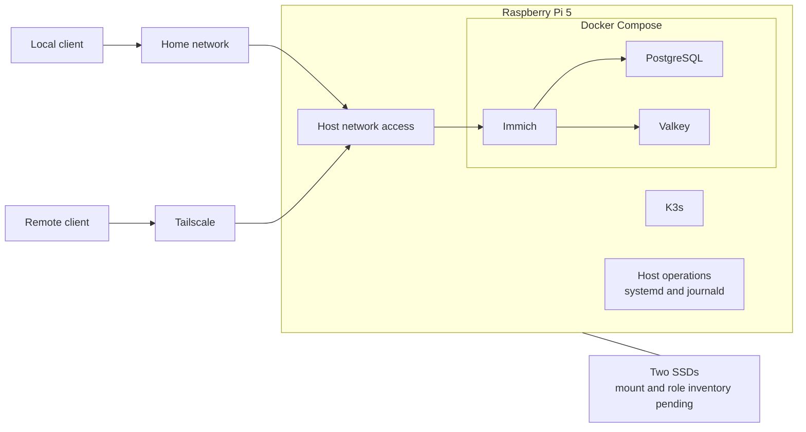

# Raspberry Pi Private Cloud

**A personal Linux homelab for self-hosted photos, private remote access and infrastructure operations.**

I am building and maintaining a private cloud on a Raspberry Pi 5, with Immich for photos and videos, Docker Compose for the application stack, and Tailscale for remote access. The project also includes work with K3s, monitoring, storage, backups and fault diagnosis.

The practical challenge is keeping personal data accessible and recoverable on a small server. This repository records the architecture, operational checks and troubleshooting decisions behind that work.

## At a glance

| Area | Project scope |
| --- | --- |
| Hardware | Raspberry Pi 5 and two SSDs |
| Photo service | Immich with Docker Compose, PostgreSQL and Valkey |
| Access | Local network and Tailscale |
| Kubernetes | K3s, including an explicit node IPv4 configuration |
| Observability | Prometheus, Grafana and kube-prometheus-stack |
| Operations | systemd backup scheduling, journald, SMART and USB diagnostics |
| Experiments | TuneD profiles and Google Photos import |

**Documentation status:** The service stack above comes from the project notes. Exact software versions, disk roles, proxy routing and recovery results are still being collected. This is a case study in progress, not a tested installation kit.

## Architecture overview

Immich is managed with Docker Compose. K3s is a separate part of the homelab; the diagram does not imply that Immich runs inside Kubernetes.

The proxy/ingress path and monitoring placement are described as open documentation items in [Architecture](docs/architecture.md).

## Technical case studies

- **K3s node address selection:** an IPv6-related `secondaryNodeIP` problem led to an explicit `node-ip` setting in the persistent K3s configuration.
- **Intermittent server freezes:** investigating the boundary between service failure, network loss and a host hang, using previous-boot logs, SSD/USB checks and power/temperature observations.
- **Mobile photo uploads:** checking client connectivity and backup settings alongside Immich logs.

See [Troubleshooting](docs/troubleshooting.md) for the symptoms, recorded actions and remaining validation. A confirmed root cause for the intermittent freezes is not yet documented.

## Read the project

| Document | What it covers |
| --- | --- |
| [Architecture](docs/architecture.md) | Services, storage boundaries and deployment details to verify |
| [Operations and recovery](docs/operations.md) | Health checks, backup validation, logs and maintenance |
| [Troubleshooting](docs/troubleshooting.md) | K3s networking, freezes and mobile upload diagnosis |
| [Evidence and next steps](docs/evidence.md) | The artifacts needed to complete the case study |

## Skills demonstrated by the work

- Administering a Linux host and investigating systemd services.
- Operating a containerized application with persistent data.
- Separating application, network and host-level failure symptoms.
- Working with Kubernetes node configuration and monitoring.
- Designing backup verification and documenting recovery requirements.

The repository focuses on configuration and operations. It does not claim authorship of Immich, K3s or the other upstream tools.

## Next milestones

- [ ] Record the OS, RAM, software versions and exact roles of both SSDs.
- [ ] Add sanitized configuration from the running system.
- [ ] Document the backup timer, retention policy and a restore test.
- [ ] Add selected dashboard screenshots with dates and context.
- [ ] Record the verification result after the K3s address fix.
- [ ] Continue the freeze investigation with retained evidence.

## Privacy

Examples use placeholders rather than the server's real addresses. Credentials, photo libraries, backups, kubeconfig and raw diagnostic exports do not belong in this repository. The ignore rules reduce accidental additions but do not inspect file contents or remove files already tracked by Git.
